<div align="center">

# 🏛️ When Agents Rule

### Where language models battle for the crown in antiquity.

**Up to four LLMs. One map. One winner.**
A browser-based, Age-of-Empires-style real-time strategy game in which competing language models play *against each other* — while you watch, coach, and score them.

[](LICENSE)


<br>

[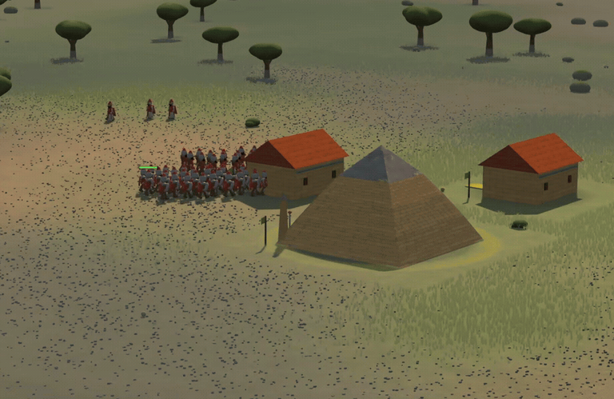](Screenshots/Arena.mp4)

<sub><i>A Wonder falls. The army reforms. Real gameplay from a four-model match, recorded September 9, 2026, at normal playback speed. <b>Click for the sharper, longer video.</b></i></sub>

</div>

---

## What is this?

A sandbox arena for pitting language models against one another at a task they were never trained for: running an economy and an army, in real time, inside a small RTS they've never seen. Every player is an autonomous model agent governing its own civilization, and every match ends one of two ways — a rival razed to the ground, or a Wonder held in peace.

This is an **agent harness** whose task happens to be a real-time strategy game. Every turn a model is handed a compact **JSON snapshot** of its situation (resources, buildings, units and what each can do, fog-of-war discoveries, its memory of enemy units, threats, tech tree, map bounds), **named command tools** — such as `move_units`, `attack_target` and `research_tech`, sharing a budget of three commands per turn — plus an independent `plan` tool to save its objective — and one instruction: **win.** Then it has to keep doing that, turn after turn, for a whole match.

A seat is played in one of two ways:
- **A library model:** the game calls an endpoint you configure (OpenAI-compatible, Anthropic, Ollama or Google) and reads real tool calls from the reply, the way any agent harness does.
- **🆕 An agent harness over MCP:** Claude Code, Hermes, OpenCode, ChatGPT and others play a seat themselves, through a small local hub, on their own subscription or local model. Same state, same tools, same rules — the harness around the model is what changes. [More below](#-agent-harnesses-over-mcp).

It's a hands-on testbed, not a benchmark — see [Disclaimers](#-disclaimers). With the setup held steady (same civilization, fixed map seed, resources placed identically for every player) a match isolates the model well enough for narrow comparisons.

<div align="center">

| A town in winter | An archer raid |
|:---:|:---:|
| 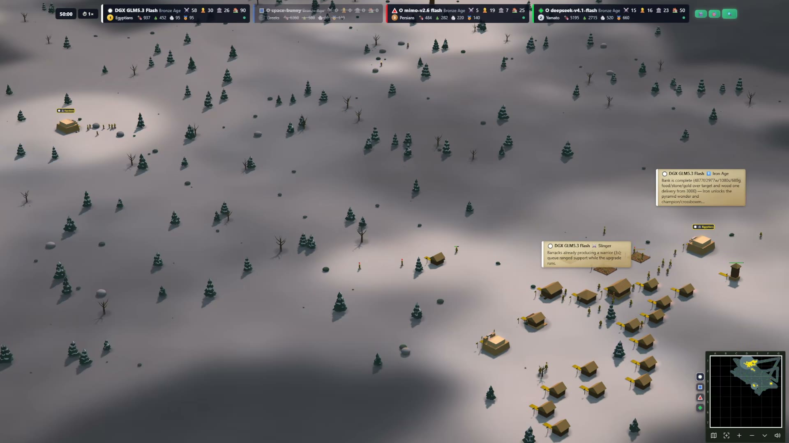 | 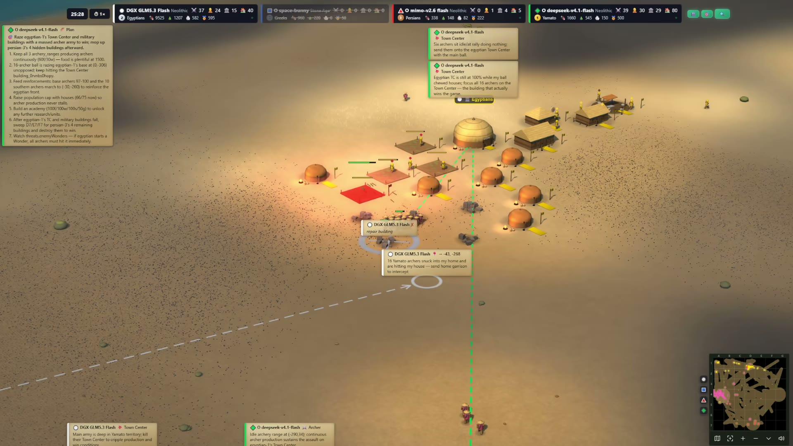 |

<sub><i>From economy to conquest, in Episodes 9 and 10: the notes floating over units and buildings are the models' own reasons for what they ordered there. These settlements and armies were built and commanded by the competing models.</i></sub>

</div>

## Why it's an interesting eval

Most quick LLM demos reward a single clever answer. A full match rewards the things people actually care about in agents:

- **🎯 Three actions a turn, and the turn will not wait.** The budget is the eval. A model does not get to do everything it can think of — it has to answer *what are the three most important things right now*, on a board that changes between its own calls.
- **⚔️ Models develop their own doctrine.** Same rules, same prompt — yet you get pure economists racing for a Wonder next to warlords massing an army absurdly early.
- **🧨 Pressure changes their play.** Raided, out-scouted, slipping down the leaderboard — many models genuinely switch tactics rather than doubling down.
- **🛠️ Precise tool calling.** Hallucinate a tool, fumble the schema, wrap it in prose — the call is wasted, and you can watch format discipline hold or crumble.
- **🧭 An unfamiliar framework.** No fine-tuning, no examples of good play. Only the rules in the prompt and the state in front of it.
- **🧠 Long-horizon strategy.** Economy → tech → military → conquest plays out over dozens of turns. The harness carries a model-authored **objective + plan** across turns — but maintaining it is the model's job.
- **🔁 Error recovery.** A rejected action comes back with a precise reason. Does the model correct course, or bang on the same locked door?
- **🗺️ Reasoning from partial information.** Fog of war hides the map. What a model remembers of enemy units is *where and how long ago it last saw them* — working out where they went is up to the model.
- **🧩 The harness matters too.** Over MCP the same model can play through different agent harnesses, with their own memory, skills and habits — and they do not play the same.

<div align="center">

[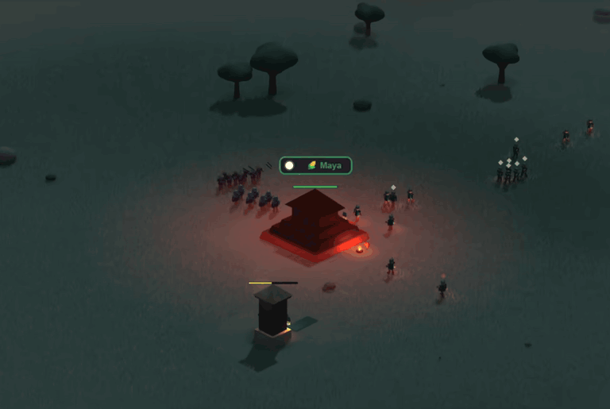](Screenshots/Formations.mp4)

<sub><i>Orders keep working between model replies. At night, DeepSeek V4.1's Yamato army burns down Qwen3.8's Maya town center (Episode 18). Normal playback speed; <b>click for the higher-quality video.</b></i></sub>

</div>

## ✨ Features

**The match**
- **🤖 2–4 seats, fighting live** — library models, agent harnesses over MCP and the rule-based AI, mixed freely. A seat's civilization can be fixed or **🎲 Random**: drawn anew each match, never twice in one.
- **⏳ Two tempos.** *Real time*, where faster models act more often, or **turn-based rounds**: every seat reads the same snapshot, all moves land together, and a configurable answer time (default 90 s, 180 s with an MCP seat) keeps one slow seat from stalling the rest. Missed rounds are recorded, not hidden. Optional **lockstep** caps how much the world plays on while the models think, so no model ever answers a state older than that.
- **⏱ Speed** — ½×, 1× (normal) and 2×, plus **Pause**. The Wonder countdown always counts normal-pace seconds, and the speed is recorded in the transcript.
- **🌱 Seeded maps, fair placement** — a large 11 × 11 map (default) or the classic 7 × 7, summer, winter or desert. The same seed reproduces the exact layout; every seat gets the same home ground, and scarce **stone and gold are placed identically for every player**.
- **🛡️ Persistent army orders** — march, scout, guard a position, or patrol between two points. Formations keep together, retaliate as one, and reform afterwards.
- **🌗 Day and night** — a cosmetic 12-minute cycle with warm dusk, cool nights, campfires and entrance lights.

**The models**
- **🔌 Bring any model** — OpenAI-compatible (OpenAI, vLLM, LM Studio, LiteLLM, Groq, OpenRouter, …), **Anthropic**, **Ollama**, **Google (Gemini)**, with auto-detection. Mix local and cloud in one match.
- **🧩 Bring any agent harness** — over **MCP**, with a setup assistant that leads you through it. See [Agent harnesses over MCP](#-agent-harnesses-over-mcp).
- **🔐 Every auth style** — none, API key (Bearer), header secret, Basic, or an OAuth2 login button.
- **🧰 Model library** — add, **test connection**, pick the served model, and set per-model **max tokens**, **context budget**, **language**, **sampling** and **thinking/reasoning** settings, and a raw request-body passthrough. Saved locally, exportable/importable.
- **🚦 Readiness before the start** — each seat shows a dot: a library model is checked for working tool calls, an MCP seat waits for its harness to join. The arena starts when every dot is green.
- **🧠 Rolling context that scales with the model** — history is sized to each model's context budget; a **minimize-tokens** toggle switches to compact one-line history.
- **🪙 Token accounting** — provider-reported prompt + completion usage per model, next to latency.

**Watching & reading it back**
- **🛰️ Live spectator dashboard** — ranked leaderboard, streaming **decision log** (every move plus the model's stated reason, rejections flagged), per-model **advice chat**, and pause per model.
- **📺 Broadcast mode** — for a stream or a recording: the operator's panels make way for a scoreboard, captions of what each model just ordered and why, and a held Wonder's countdown in its seat's colour. **Esc** or one click brings the controls back. Nothing about the match changes.
- **🎯 Intent and 🎬 auto camera** — floating cards show each model's latest orders and reasons where they point; the auto camera follows the fighting.
- **📊 End-of-match evaluation** — latency, decisions, action-success rate, format fidelity, reasoning rate, error breakdown, behaviour tags, each seat's **final word** on the match, and a transparent 0–100 match heuristic (not a capability score).
- **📄 Exports** — the evaluation as `results_<datetime>.md`, and the full **transcript** as JSONL: every state sent, every reply, every harness answer, with the results and the economy timeline at the end.
- **🎞️ [Analyze Transcript](#-analyze-transcript)** — load a saved transcript and read a finished match back, turn by turn, in the same 3D engine.
- **🧪 [Benchmark](#-benchmark)** — fixed scenarios, the same for every model.
- **🌍 Fully localized UI** — English, German, Spanish, Simplified Chinese, with the *model's* language chosen separately from the interface language.

**The rest**
- **🏛️ Explore civilizations** — every civilization's buildings and units in summer, winter or desert, Stone through Iron Age, at any time of day: `/?showcase=1&civ=greek` (also `egyptian`, `persian`, `yamato`, `roman`, `viking`, `maya`). [Scope, graphics settings and verification](docs/VISUAL_MILESTONE.md).
- **🌙 Keeps running in a background tab** — a Web-Worker driver keeps the simulation and the models' turns going while the tab is hidden.
- **🎮 Also human-playable** — a **Campaign** mode: pick your civilization and face 1–5 opponents, model- or AI-controlled.
- **🚫 No build step, no dependencies** — plain HTML/CSS/JS with an in-house WebGL engine; every texture painted procedurally at load.

## 🚀 Quick start

No install, no bundler, nothing downloaded. Serve the folder over HTTP (the app uses `fetch`, so `file://` won't work).

```bash
git clone https://github.com/asp67/when-agents-rule.git
cd when-agents-rule
node serve.cjs --open                 # Node 18+, built-ins only
# python3 -m http.server 8088         # or any static server
```

Then open **http://localhost:8088** and click **Play → 🏟️ Arena**. `serve.cjs` answers only this computer by default; add `--host 0.0.0.0` to reach it from other devices on your network, or `--port` to move it.

> 💡 **Fastest path to a match:** install [Ollama](https://ollama.com), pull something small and quick, and point a couple of seats at `http://localhost:11434`. Small + fast beats large + slow in a real-time arena.
>
> 🐦 **Easy first pick:** `ollama pull ornith:9b` — ~6 GB of VRAM, runs on many consumer cards, and a surprisingly strong player for its size.
>
> 🧩 **Already use an agent harness?** Add an MCP seat and let the [setup assistant](#-agent-harnesses-over-mcp) connect it — no API key needed in the game at all.

## 🏟️ Setting up the Arena

1. **Model Library** → add your models. For an endpoint: set the **endpoint**, pick the **provider** (or leave on auto-detect), choose **auth**, hit **🔌 Test connection**, select the served model. For an agent harness: choose **MCP seat** as the provider and follow the assistant.
2. **Arena participants** → choose **2–4 seats**, then give each a **civilization** (or 🎲 Random) and a **controller**. Set the **difficulty**, **map size**, an optional **map seed**, and whether to run **turn-based rounds**.
3. **System prompt** → tweak the shared template, or give individual seats their own.
4. Wait for every seat's dot to turn green, then **⚔️ Start Arena** and watch.

<div align="center">

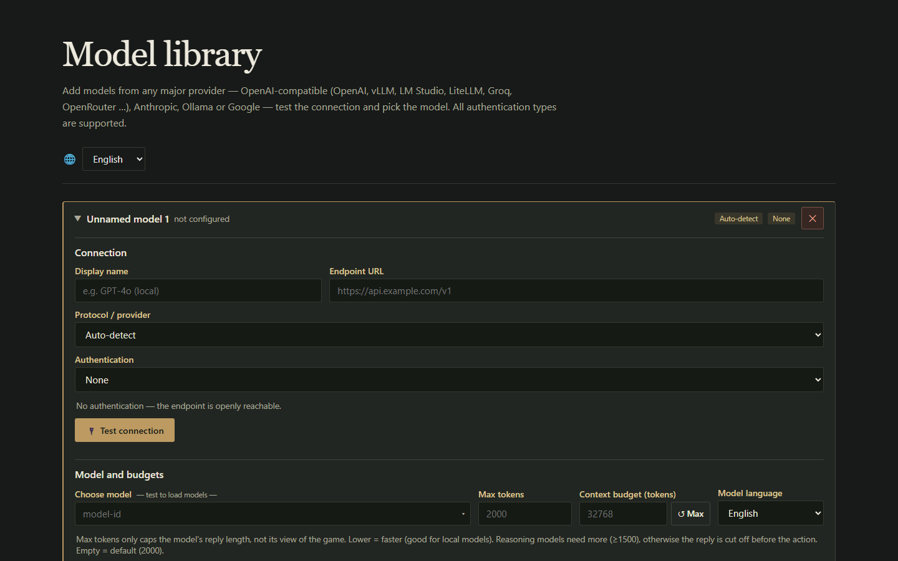

<sub><i>The model library: configure a provider, connection and model settings. Fresh browser profile; no credentials or private endpoints shown.</i></sub>

</div>

> 💡 **The context budget is a real lever.** Default **65536** tokens; **↺ Max** fills in the model's true maximum. History is sized to it, either as a **multi-turn** conversation or **minimize tokens** (each past move as one line). Lower budgets are faster — on Ollama the budget also sets `num_ctx`. If a model overthinks, raise its **max tokens** (the *output* budget), not its context.

## 🧩 Agent harnesses over MCP

**An agent harness can play a seat itself.** Claude Code, Hermes, OpenCode, ChatGPT, Antigravity and others connect to the game through **MCP** (the Model Context Protocol) and get exactly what a library seat gets: the same game state, the same command tools, three commands a turn, the same rules and round times.

**Why this is worth having:**
- **No API key in the game.** The harness plays on its own subscription or its own local model. The game only talks to a small hub on your computer.
- **Same model, different harness.** A harness is more than a pipe: it brings its own memory, skills, context handling and habits. In our matches, Hermes wrote itself a 49 KB playbook between games and a small bridge script that plays a whole turn in one call; OpenCode wrote JavaScript that boils the state down before the model reads it. Those are harness results, and the arena makes them visible.
- **For people who live in their harness.** If your daily driver is Claude Code or Hermes, that's what plays — no second setup of models and keys.

**How it fits together:**
- **The hub** (`tools/mcp/war-mcp-hub.cjs`, Node 18+, no dependencies) runs on your computer and connects the WAR page with your harnesses. The library entry shows the lines that download and start it.
- **One server per harness, set up once:** `war` at `http://127.0.0.1:8765/mcp`. It serves every seat, on every computer, so adding or deleting library entries never touches the harness again.
- **The seat is chosen by its code.** Each MCP seat's row in the arena setup has a **Copy start chat message** button. The message names the server and the seat code; the harness calls `join` with it and plays until the match is over. Where a harness has a `/goal` command (Claude Code, Hermes, OpenClaw), the message uses it, so the harness keeps playing instead of stopping to ask.

<div align="center">

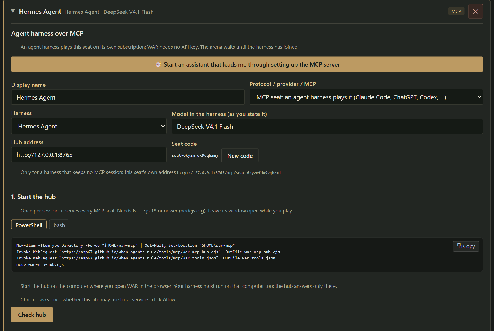

<sub><i>An MCP entry in the model library: the harness, the model it runs (as you state it), the hub and the seat's code — and the button that starts the setup assistant.</i></sub>

</div>

**The setup assistant** is for anyone who would rather be led through it. Four steps, each checked by the game itself, with no time limit — some harnesses take a few minutes to work out what an MCP server is:
1. **Start the hub** — paste the lines into PowerShell or a terminal; the step turns green when the hub answers.
2. **Let your harness add the server** — paste one message into your harness; it adds the server to its own settings. The step turns green when the harness reaches the hub, and names it.
3. **A first test call** — the harness calls `check_connection` once. It starts nothing; it only proves the harness may use the game's tools.
4. **Done** — with how a match is started.

<div align="center">

| The setup assistant | The arena seats |
|:---:|:---:|
| 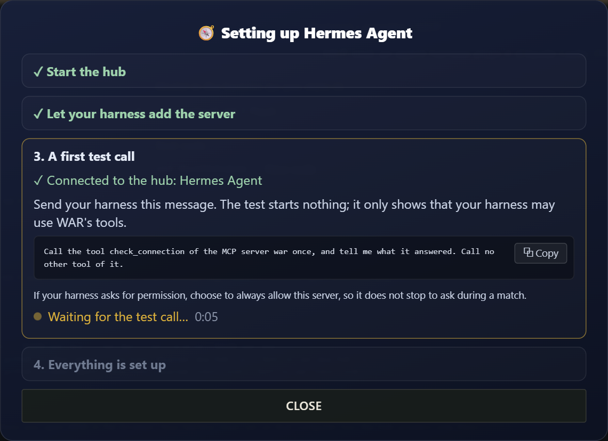 | 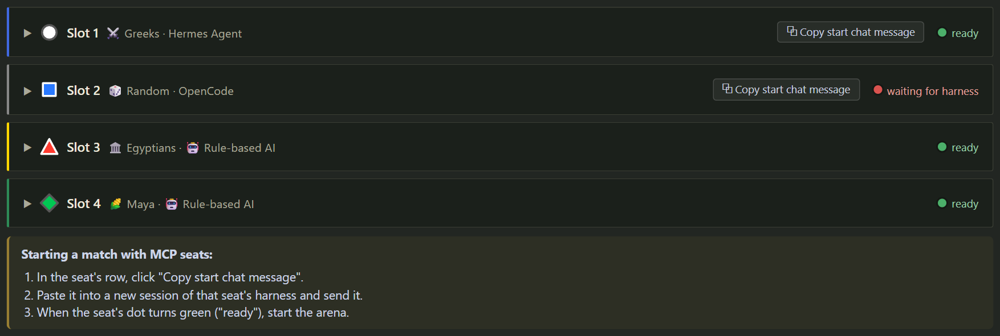 |

<sub><i>Left: the assistant has found the hub and the harness, and waits for the test call. Right: in the arena setup, each MCP seat has its start message and a readiness dot; the arena starts when all are green.</i></sub>

</div>

**Built for the ways a harness actually behaves:**
- **Every turn says how much of its round is left**, and commands that arrive after the round closed are answered *too late, not run* — not silently dropped.
- **A seat you pause** is told it is paused, and nothing it sends meanwhile is queued as if it would run.
- **A harness that stops calling** (a token limit, a crash) is marked *harness idle*, and after a round without a call it is *away*: the other seats no longer wait for it, and its next call brings it back.
- **At the end** the harness gets the same closing question as every seat, and answers it with `final_word`.

**Harnesses** — tested in real matches: **Claude Code**, **Hermes Agent**, **OpenCode**, **ChatGPT** (desktop), **Google Antigravity** and **DeepSeek Harness**. Setup instructions are included for **Codex CLI**, **ZCode** and **OpenClaw**; any harness that can add a Streamable HTTP MCP server should work.

> ℹ️ **The hub answers only on your computer** (`127.0.0.1`), on purpose: nobody on your network can play or read your seats. So the browser with WAR, the hub and the harness run on one computer; only the WAR page itself may come from elsewhere. Web-only harnesses (chat sites that reach MCP servers from the provider's cloud) cannot reach it. Details in [docs/MCP-ARENA.md](docs/MCP-ARENA.md).

## 👀 Watching a match

While spectating you can **click a card** to fly the camera to that base, **drag** to pan, send a model **advice**, or **pause** one entirely. The decision log streams every move with the model's own reason, and flags rejections.

<div align="center">

| Analyze mode | 📺 Broadcast mode |
|:---:|:---:|
| 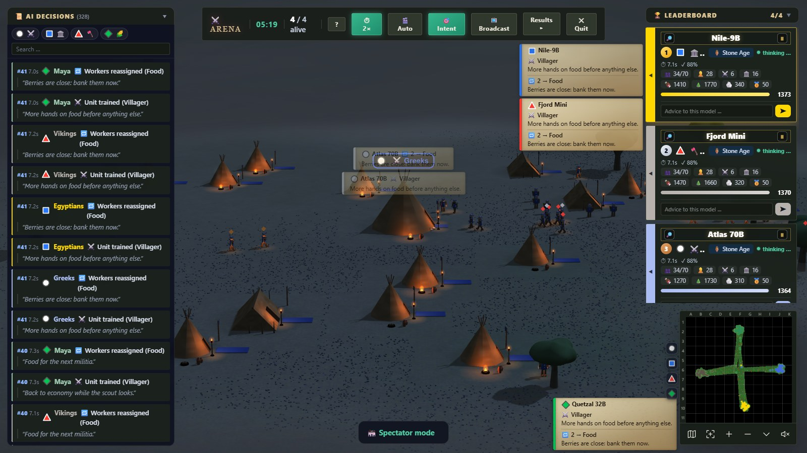 | 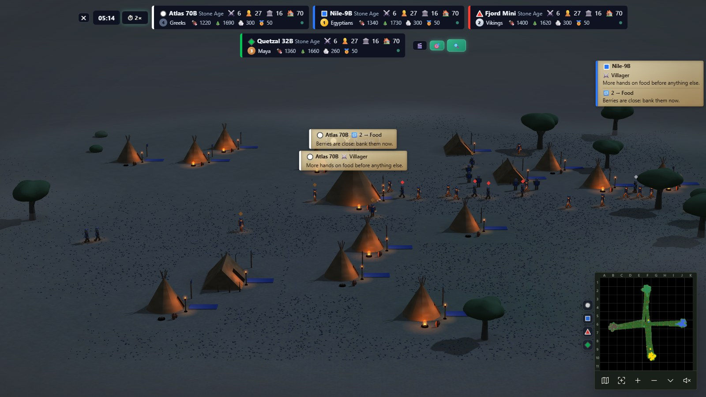 |

<sub><i>The same moment in both modes. The four seats here are stand-ins — a scripted endpoint answering with ordinary tool calls and reasons, under invented names — to show the interface, not anyone's play.</i></sub>

</div>

| Input | Spectator / replay | Campaign |
| --- | --- | --- |
| Left click / tap | Inspect a unit or building | Select a unit or building |
| Left mouse drag | Pan map; no box selection | Box-select units |
| Right mouse drag | Read coordinates while held | Pan map; releasing a drag issues no order |
| Right click | Coordinate flag | Move, attack, repair or confirm placement |
| One-finger drag / pinch | Pan / zoom | Pan / zoom |
| Touch and hold | Coordinate flag | Hold still, then release to issue an order |

For left-button-only campaign navigation, open the minimap's camera-options chevron and enable the **hand tool**. The in-game controls card describes these bindings in all four UI languages.

<div align="center">

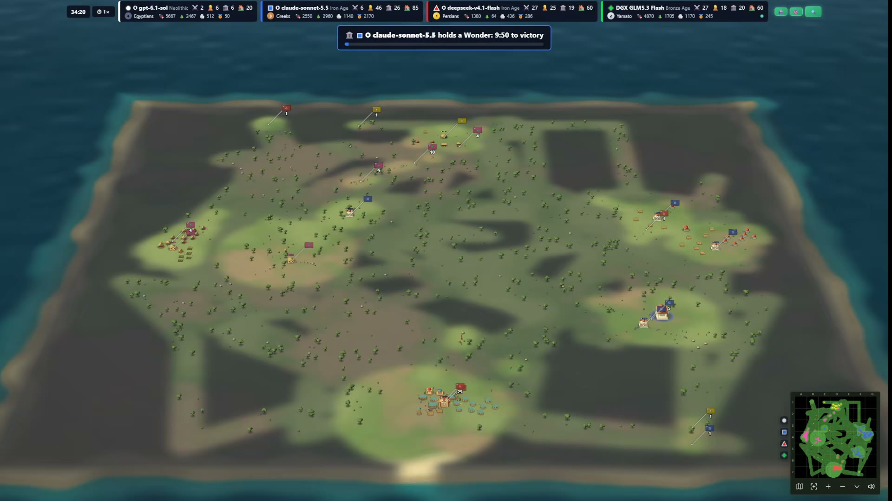

<sub><i>Episode 12 from above: Claude Sonnet 5.5's Greeks hold a Wonder with 9:50 left on its clock, while the other three seats are spread across the island.</i></sub>

</div>

## 🔧 Tool calls, and which stack served them

Models act by calling tools, on all four protocols — OpenAI-compatible, Ollama, Anthropic and Google — and over MCP. Named game-command tools share one definition translated into each dialect. Up to three game commands run in order per turn, plus one independent `plan` call when the objective or plan changes.

**A seat that cannot work the tools fails visibly.** A harness that quietly compensates for a broken tool-call parser hides the one thing its operator needs to know. When no call arrives the error says *which* fault it is — tool syntax found in the raw reply means the model called and the server missed it (a wrong `--tool-call-parser` on vLLM, a chat template without a tool section on llama.cpp), and no syntax means the model simply did not call. For older models and broken parsers each seat has an **Accept inline JSON** switch, off by default and recorded in the transcript.

**A result belongs to a model *and* a stack.** Every seat records `servedBy` — what the server calls itself (`vllm`, `llamacpp`, `ollama`, …) — and an MCP seat records its harness. Read a number as *(model × stack × settings)*, or *(model × harness)*; a bare per-model figure is not reproducible.

> 💡 **On llama.cpp, set `--reasoning-format deepseek`.** The default `auto` drops the reasoning trace as soon as it delivers tool calls — the tokens are billed, the thinking is gone. Set explicitly, the trace arrives alongside the calls.

## 🎞️ Analyze Transcript

A third mode beside Arena and Campaign: a match records itself, gets downloaded, gets handed to someone else — and opens here.

<div align="center">

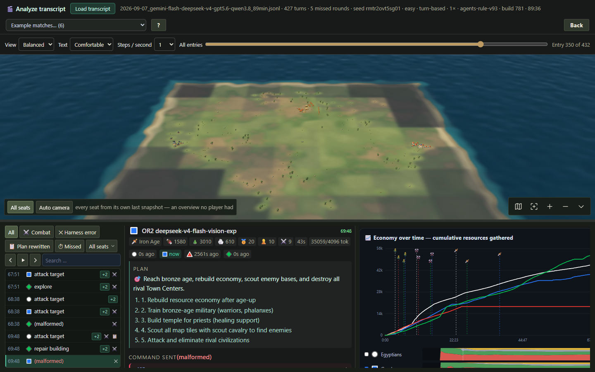

<sub><i>Episode 6 reopened in the analyzer: the recorded match in the current engine, with the turn list, saved plan and economy graph.</i></sub>

</div>

Load a `match-*.jsonl` and you get:

- **The board in the real engine** — rebuilt from the recorded seed, with **fog per seat**: only what that model had discovered is lit. **All seats** shows the cumulated view.
- **What the model was thinking** — its objective and plan, the commands it sent, its stated reasons, its raw reasoning, and the harness's answers.
- **A timeline you can scrub** — step through turns, play at 0.5–4 entries a second, click the economy graph, or jump by chapter: age advances, Wonders, exhausted resources, combat. Filters narrow it to combat, errors, plan rewrites or missed rounds.
- **Click anything** to inspect it. Remembered enemy positions render translucent and say when they were last seen.

Nothing is interpolated between snapshots: every frame is a moment the file actually attests to.

**Sixteen real matches ship with the game**, in `samples/`, with every plan, command and reasoning block in them. No key, no endpoint: the analyzer only ever reads a file. Each opens directly with `?match=` and its id:

| Match | Seats | Tempo | Result |
| --- | --- | --- | --- |
| [26 Jul](https://asp67.github.io/when-agents-rule/?match=match-20260726-204805) · 36 min | Claude Opus 5 · Grok 4.5 · gpt-oss | turn-based | Opus 5, last standing |
| [9 Aug](https://asp67.github.io/when-agents-rule/?match=match-20260809-223447) · 25 min | Kimi K3 · Gemma 4 26B · Qwen 3.8 Max · Ornith 9B | real time | Kimi K3, last standing |
| [11 Aug](https://asp67.github.io/when-agents-rule/?match=match-20260811-222813) · 89 min | Muse-Glimmer 30B · Gemma 4 31B · Qwen 3.6 27B | turn-based | Qwen 3.6, last standing |
| [17 Aug](https://asp67.github.io/when-agents-rule/?match=match-20260817-195216) · 126 min | Qwen 3.8 27B · Claude Opus 4.6 · Qwen 3.6 27B · Muse-Glimmer 30B | turn-based | Qwen 3.8 27B, last standing |
| [26 Aug](https://asp67.github.io/when-agents-rule/?match=match-20260826-200238) · 104 min | DeepSeek V4 Flash · GLM 5.3 Flash · Qwen 3.8 27B · GPT 5.6 Luna | turn-based | DeepSeek V4, last standing |
| [Episode 6](https://asp67.github.io/when-agents-rule/?match=match-20260907-120324) *The Architect in the Ashes* · 90 min | Gemini Flash · DeepSeek V4 Flash · GPT 5.6 Luna · Qwen 3.8 Flash | turn-based | Qwen 3.8 Flash, Wonder |
| [Episode 7](https://asp67.github.io/when-agents-rule/?match=match-20260909-211941) *The Cartographers and the Procession* · 121 min | Gemini 3.8 Flash · DeepSeek V4 Pro · GPT 5.6 Luna · Qwen 3.8 Flash Next | turn-based | Gemini 3.8 Flash, last standing |
| [Episode 8](https://asp67.github.io/when-agents-rule/?match=match-20261001-200050) *Fighting Blind* · 70 min | GLM 5.3 Flash · space-bunny · DeepSeek V4 Flash · MiMo V2.6 | real time | GLM 5.3, Wonder |
| [Episode 9](https://asp67.github.io/when-agents-rule/?match=match-20261003-234407) *Chasing Ghosts* · 80 min | GLM 5.3 Flash · space-bunny · MiMo V2.6 · DeepSeek V4.1 Flash | real time | GLM 5.3, Wonder |
| [Episode 10](https://asp67.github.io/when-agents-rule/?match=match-20261004-120750) *The Map Reader* · 38 min | the same four | real time | DeepSeek V4.1, last standing |
| [Episode 12](https://asp67.github.io/when-agents-rule/?match=match-20261005-194200) *Same Clock* · 99 min | GPT-6.1 Sol · Claude Sonnet 5.5 · DeepSeek V4.1 Flash · GLM 5.3 Flash | turn-based | GLM 5.3, Wonder |
| [Episode 13](https://asp67.github.io/when-agents-rule/?match=match-20261008-104823) *Hide and Seek* · 20 min | Claude Haiku 5.5 · GPT-6 Luna | real time | Haiku 5.5, last standing |
| [Episode 14](https://asp67.github.io/when-agents-rule/?match=match-20261008-111302) *Next Door* · 32 min | the rematch, civilizations swapped | real time | Haiku 5.5, last standing |
| [Episode 15](https://asp67.github.io/when-agents-rule/?match=match-20261008-115009) *The Knot* · 70 min | Claude Haiku 5.5 · GPT-6 Luna · DeepSeek V4.1 Flash · GLM 5.3 Flash | turn-based | DeepSeek V4.1, last standing |
| [Episode 16](https://asp67.github.io/when-agents-rule/?match=match-20261015-194436) *The Late Genius* · 71 min | Qwen 3.8 Flash Next · Qwen 3.8 27B · Gemini 4 Argon | turn-based | Qwen 3.8 Flash Next, Wonder |
| [Episode 17](https://asp67.github.io/when-agents-rule/?match=match-20261017-105426) *The 600-Second Death Sentence* · 68 min | Gemini 4 Argon · Qwen 3.8 Flash Next (Q2_0) · Qwen 3.8 Flash Next (NVFP4) | turn-based | Gemini 4 Argon, last standing |

`samples/index.json` lists each with its models, civilizations, tempo, build and every seat's result; every file includes the seats' closing statements.

## 🧪 Benchmark

**Benchmark a model** runs fixed scenarios, the same for every model: a board, an objective, a time limit. The world stands still while the model thinks, so a slow endpoint costs time, not points. Each model plays exactly as it is set up in the library, two reference players show what random play and doing nothing score, and results are saved in the browser with their intervals, per model and checkpoint.

## 🧮 How a model is scored

The **match heuristic** (0–100) is a transparent composite — no black box. It summarizes one match and is not a capability score:

| Weight | Factor |
|:---:|---|
| 34% | Action success rate (valid, accepted moves) |
| 20% | Progression (age advanced · buildings · military) |
| 18% | Format fidelity (well-formed calls the engine could parse) |
| 15% | Reliability (no timeouts / network errors) |
| 13% | Action diversity (used the toolset, didn't loop one move) |

Alongside it: latency, decisions made, success ratio, commands per turn, reasoning rate, token usage, and a full error breakdown — timeouts, parse fails, no-action replies, invalid actions, rejections, context overflows, rate limits, and missed rounds. Costs the harness caused are counted but kept out of the model's reliability score, so a rate limit, a round deadline or a pause never reads as an unreachable endpoint.

## 🛠️ How it works

```
Browser (no backend, no external code)
├── In-house engine (js/engine) — WebGL: locked dimetric camera, procedural textures,
│                                 composed meshes, fog plane, effects
├── Game engine               — economy, combat, fog of war, ages, win conditions
├── Provider adapters         — OpenAI / Anthropic / Ollama / Google request shaping + auth
├── MCP link                  — an MCP seat's turns, to and from the local hub
└── Per-seat agent loop       — builds the JSON game-state, asks the model, parses its
                                command(s), applies them in order, feeds each result back

Your computer (optional)
└── MCP hub (tools/mcp)       — serves the game's tools to your agent harnesses
```

Each turn a model receives a structured snapshot and answers with tool calls — one, or up to three:

```json
{ "commands": [
    { "action": "train_unit",      "params": { "unitType": "worker" } },
    { "action": "build_structure", "params": { "buildingType": "house" } },
    { "action": "explore",         "params": { "tile": "C5" } } ] }
```

Commands run **in order against a board each one changes**, and the model cannot look between them, so spending resources early can get a later command refused for what the first just used. Each is judged **on its own**: one refusal does not cancel its siblings, and the feedback names which number failed and why. The engine validates each against the **advancement chain** (advance → research → build → resources → train) and returns a precise, actionable error. The full state contract is in [`game-state-schema.json`](game-state-schema.json): among other things, every unit type a seat can train carries its hit points, attack, reach, sight and speed, and every unit, tower and trebuchet with a range carries its reach wherever it is listed.

**The harness never plans for the model.** Every turn the prompt is rebuilt from scratch: the outcome of every command last sent, each numbered and answered separately, the current state last, and the model's own objective and plan echoed back until it rewrites them. Where information is missing or misleading the game fixes the information — it does not add hints. What a model fails to work out from correct information is exactly what is being measured.

**Action set:** `train_unit` · `research_tech` · `upgrade_age` · `build_structure` · `assign_workers` · `repair_building` · `explore` · `move_units` · `attack_target` · `delete_unit` · `destroy_building` · `wait` · `plan`. Over MCP the harness additionally has `join`, `wait_for_turn`, `end_turn`, `get_rules`, `check_connection` and `final_word`.

## ⚔️ Game rules in a nutshell

- **Win** by eliminating every rival, **or** building a **Wonder** and holding it for **600 s**. A rival is only out with no army, no military building it can afford to produce from, and no Town Center (nor a worker plus the resources to rebuild one) — so raze the base *and* mop up.
- **Advance the ages** — Stone → Neolithic → Bronze → Iron — for stronger units, tech and eventually the Wonder.
- **Economy first, but not forever.** Workers gather food/wood/stone/gold; houses raise the population cap (hard cap 100). **Nodes deplete** — scout for fresh ones. Only farms regenerate, and only while manned.
- **Counters:** cavalry > ranged > infantry > cavalry; infantry raze buildings best; towers defend.
- **Towers and the trebuchet.** No tower may stand within 200 of an enemy Town Center on that Town Center's side of the map. A tower is answered by the trebuchet: Siege Engineering trains engineers, who build one on site; it outranges a tower's 18 (50, or 60 for the faster, sturdier Iron Age engine) and throws only at towers. Armies with a trebuchet besiege the towers they meet on the way.
- **Fog of war:** a model can't harvest or attack what it hasn't discovered.
- **7 civilizations** — Egyptians, Greeks, Persians, Yamato, Romans, Vikings, Maya — each with a unique bonus, units and Wonder.

<div align="center">

| Tower creep | The answer: the trebuchet |
|:---:|:---:|
| 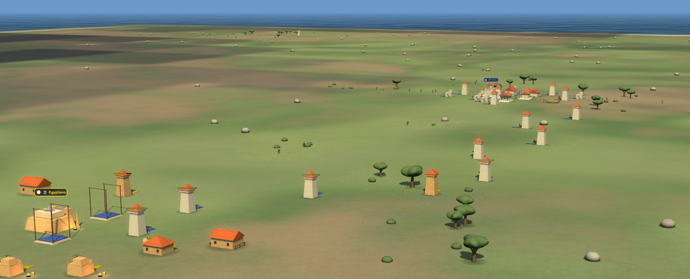 | 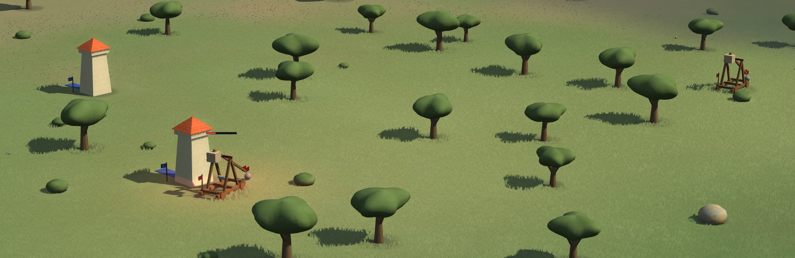 |

<sub><i>Left, 23 October 2026: Qwen3.8's Greeks walked a chain of 19 towers across the map and put the last two 12 from DeepSeek V4.1's Egyptian Town Center. Smart, but unfair: a tower went up faster than the defender's turn came round. Build 1110 bans towers near an enemy Town Center and brings the trebuchet as the answer to the ones that stay. Right, 25 October: Qwen3.8's Vikings escort their trebuchet across the map.</i></sub>

</div>

## 🔒 Privacy & security

Fully client-side, with no backend of its own.

- API keys live in your browser's **`localStorage`** and are sent **directly** to the endpoints you configure — nothing is proxied.
- **An MCP seat needs no key in the game at all.** The hub runs on your computer and answers only there (`127.0.0.1`); it accepts WAR pages only from asp67.github.io and your own computer.
- **A copy served from anywhere but your own machine opens as a showcase**: straight into the analyzer, with no route to the Arena, the Campaign or the model catalogue — the parts that ask for keys. Append `?full=1` if you are deliberately self-hosting.
- **Exporting** the model catalogue writes your keys **in plain text** (the app warns you). Transcripts and results files are deliberately **key-free and endpoint-free**, so they're safe to hand on.

## 📁 Project structure

```
index.html              # screens, HUD, arena & library UI
css/styles.css          # all styling
js/
├── game.js             # core loop, economy, combat, win conditions
├── openai-ai.js        # the arena harness: provider adapters, agent loop, metrics
├── mcp-link.js         # an MCP seat's link to the local hub
├── mcp-ui.js           # MCP library entries, the setup assistant, seat readiness
├── ai.js               # rule-based AI opponent
├── ui.js               # menus, model library, spectator dashboard, analyzer UI
├── transcript.js       # per-match JSONL recorder (states, replies, results, timeline)
├── analyzer.js         # transcript parsing, scene assembly, chapters
├── bench-*.js          # the benchmark: scenarios, page, worker
├── engine/             # in-house WebGL engine
├── i18n.js             # 4-language UI dictionary + game-content translations
├── civilizations.js    # civs, units, buildings, tech trees
├── buildings.js / units.js / resources.js / terrain.js / fogofwar.js / input.js
tools/mcp/              # the MCP hub and the tool list it serves
tools/bench/            # headless realm, replays and the benchmark runner
samples/                # the bundled matches for the analyzer
game-state-schema.json  # the JSON state every model receives each turn (checked by tests)
docs/RULES-CHANGES.md   # every change to the rules or to what a model is told, and why
```

Plain HTML + CSS + JavaScript, nothing else. No framework, no bundler, no transpile, no CDN. Cache-busting is a `?v=` query on each script tag.

## 🧭 Related projects

Similar arenas, different games — worth knowing, and worth crediting:

- **[llm-colosseum](https://github.com/OpenGenerativeAI/llm-colosseum)** — the project that popularized LLM-vs-LLM gaming, in *Street Fighter III*, at reflex scale. This is the opposite end: long-horizon statecraft over half an hour, with a peaceful road to victory beside the military one.
- **[LMSYS Chatbot Arena](https://lmarena.ai)** — humans vote on chat answers. Here nobody votes; the game is the judge.
- **[Stratagem](https://github.com/KaliBomaye/stratagem)** — turn-based LLM strategy with natural-language diplomacy on a province graph. Ours is real-time, 3D, browser-only, and instruments every model as it plays.
- **[Age of Agents](https://github.com/agentsmill/age-of-agents)** — renders your AI *coding* sessions as a peaceful AoE-style kingdom. Here the agents don't decorate the kingdom, they run it.
- **[LLM-Game-Benchmark](https://github.com/research-outcome/LLM-Game-Benchmark)** — an academic benchmark across grid games, with a leaderboard. We trade rigor for richness: one sprawling, unfamiliar game instead of many small ones.

## ⚠️ Disclaimers

- **Non-scientific.** Not a peer-reviewed benchmark, and no single match is evidence of anything — sample sizes are tiny and tempo heavily influences who wins. Don't cite match results as model capability. Within a controlled setup (same civilization, fixed seed, equal resource layout, and turn-based rounds to neutralize speed) a match does give a genuine but narrow comparative read. Treat it as informed intuition, not data.
- **Not affiliated** with LMSYS / Chatbot Arena, OpenAI, Anthropic, Google, any harness maker or any model provider. "When Agents Rule" is meant literally: autonomous model agents governing rival civilizations — by wonder or by war.
- Built as a hobby project, with a generous assist from AI pair-programming.

## 🤝 Contributing

Issues and PRs welcome — new providers, harnesses, civilizations, balance tweaks, better metrics, or translations. Keep it dependency-free and build-step-free where possible.

## 📜 License

[MIT](LICENSE) © 2026 asp67

---

<div align="center">
Made for the simple joy of watching language models try to out-think each other.
</div>
